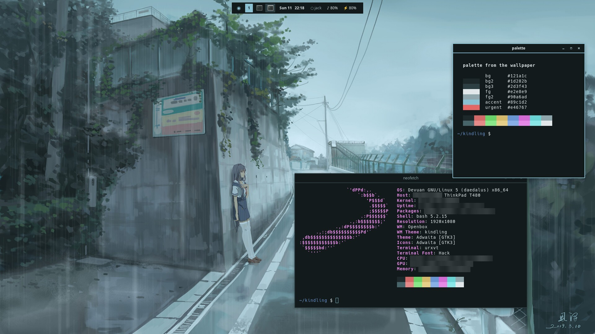
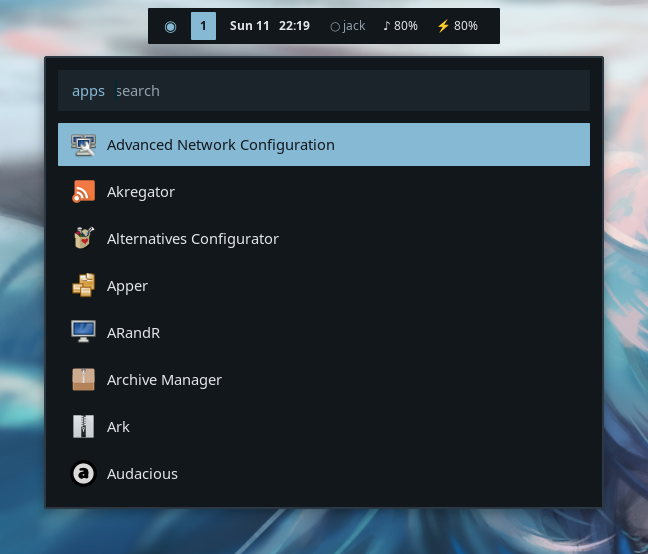
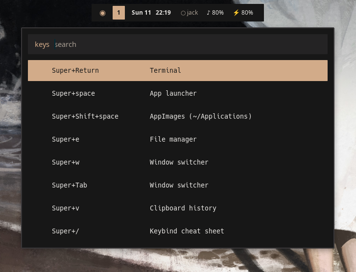
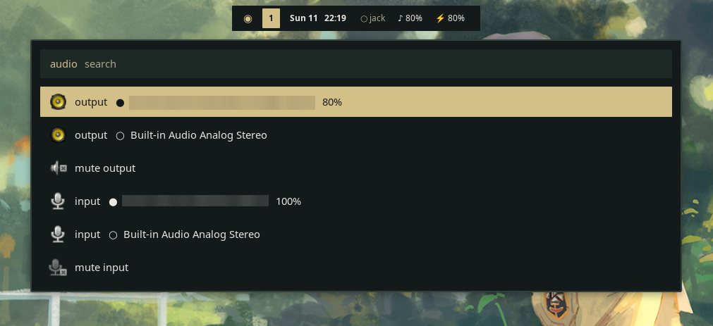
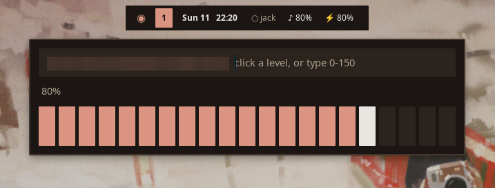
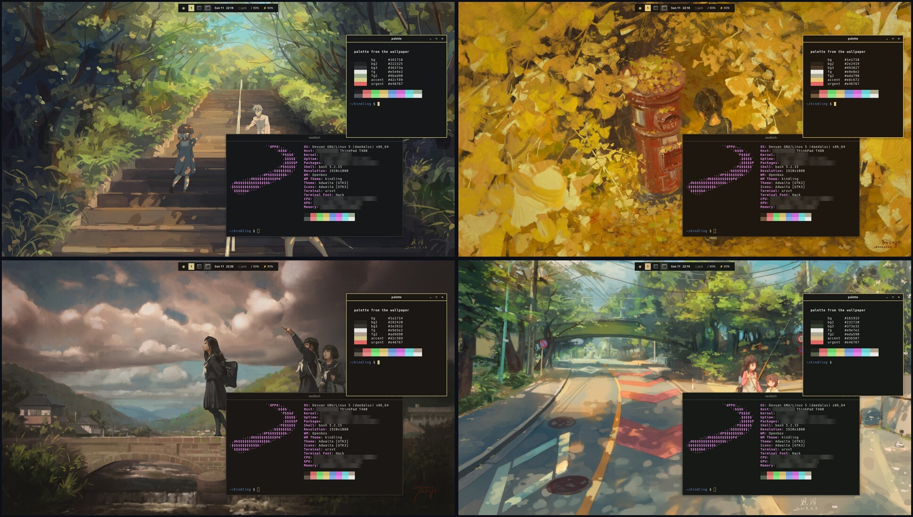

# Kindling

A lightweight desktop for old machines, inspired by [minflair](https://github.com/t4lentles5/minflair): Openbox + tint2 + rofi + dunst, themed from your wallpaper. No Qt, no Python, no systemd (built on Devuan; works on Debian too).



<sub>Each screenshot uses a different wallpaper, so each has its own theme. Wallpaper art by xiaobanbei_milk.</sub>

## Requirements

- An X11 setup on Debian or Devuan with `apt`. It has not been tried on other distributions or on Wayland.
- A few wallpapers: `mkdir -p ~/Pictures/Pape` and put images there (or set `KD_WALLDIR` to another folder). The theme is built from your wallpaper.
- Optional tray applets: `nm-applet` (wifi) and `blueman-applet` (Bluetooth). The session starts them if they are installed.

## Install

```
git clone https://github.com/LukeM-99/Kindling.git
cd Kindling
./install.sh        # then log out and pick "kindling"
```

Read `install.sh` before you run it. It changes your system:

- Runs `sudo apt install` for about 30 packages (openbox, tint2, rofi, dunst, picom, feh, imagemagick, maim, xclip, xdotool, xsecurelock, xss-lock, brightnessctl, pamixer, jq, playerctl, rxvt-unicode, pcmanfm, arandr, xsettingsd, jackd2 and friends).
- Answers `yes` to jackd2's real-time priority question, and adds your user to the `audio` and `video` groups.
- Symlinks configs and scripts from the clone into `~/.config`, `~/.local/bin` and `~/.asoundrc`. Anything already there that is not a symlink is moved to `~/.dotfiles_backup/<date>/` first.
- Adds `/usr/local/bin/kindling-session` and `/usr/share/xsessions/kindling.desktop` (with `sudo`) so the session shows up on your login screen.

Because the files are symlinks, keep the clone where it is. Moving or deleting it breaks the desktop.

## Uninstall

Run these from the clone, then log in to another session:

```
for f in bin/*; do rm -f ~/.local/bin/"${f#bin/}"; done
rm -f ~/.config/openbox/{autostart,environment,menu.xml,rc.xml} ~/.config/dunst/dunstrc ~/.config/rofi/config.rasi ~/.config/picom ~/.asoundrc
sudo rm -f /usr/local/bin/kindling-session /usr/share/xsessions/kindling.desktop
rm -rf ~/.cache/kindling ~/.config/kindling
```

Put back anything you want from `~/.dotfiles_backup/`. The installed apt packages and group memberships stay; remove them yourself if you no longer want them.

## Using it

`Ctrl+Alt+W` picks a wallpaper and recolours everything; `Super+/` lists all keybinds; `Super+G` turns the compositor off for the leanest mode. `Super+Shift+Space` launches AppImages from `~/Applications` (override with `KD_APPDIR`).

<p> </p>

## Scaling

`Super+=` / `Super+-` / `Super+0` step the UI scale (100–200%) for the current screen layout and reset it; each layout remembers its own (`~/.config/kindling/scale`). The laptop panel alone defaults to 150%, anything with an external screen to 100%. It sets `Xft.dpi` and XSETTINGS (via `xsettingsd`, so GTK apps like Firefox rescale live; others on restart) and re-renders kindling's own sizes: templates mark them `{{s N}}`. X11 has one DPI for all screens, so mixed layouts use one scale.

## Audio

The `♪` in the bar: click for a volume slider (click a level, or type a number up to 150 and press Enter), right-click for devices and apps, middle-click to mute, scroll to step 5%. The right-click menu switches output or input device (playing streams move with it), mutes the output or the mic, and sets each app's own volume; it also opens `pavucontrol` if you've installed it. The same menu is "Audio" in the desktop menu. The bar's number updates as soon as the volume changes, from `pactl subscribe`.

<p> </p>

## JACK

`Super+A` (or clicking `○ jack` in the bar) starts jackd on an ALSA card you pick and bridges PulseAudio into it, so desktop audio keeps working; again stops it and hands the card back to Pulse. `Super+Shift+A` is a rofi patchbay. ALSA apps can skip Pulse with the `jack` device (`aplay -D jack`). Defaults: 48 kHz, 256-frame periods; override with `KD_JACK_RATE`, `KD_JACK_PERIOD`, `KD_JACK_DEV=hw:PCH`.

## How theming works

`bin/kd-theme` shrinks the wallpaper to 8 colours, picks background/foreground/accent roles, fills the `{{placeholders}}` in `templates/`, and reloads Openbox, tint2, dunst and open urxvt windows. Generated files go to `~/.cache/kindling/`.



## Licence

GPL-3.0. See `LICENSE`.
